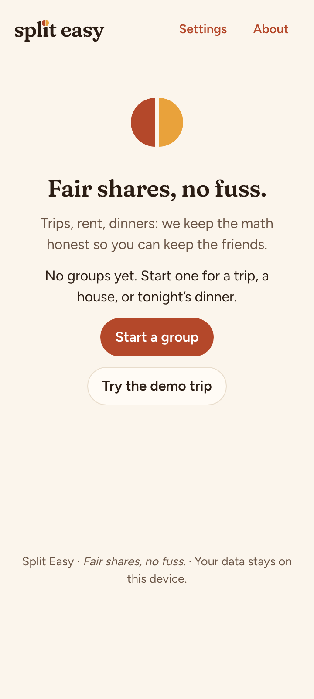
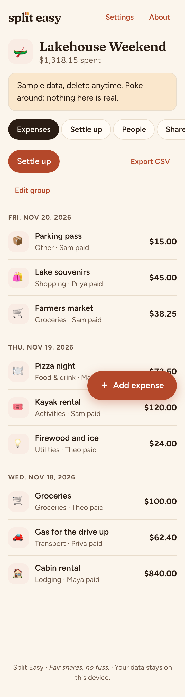
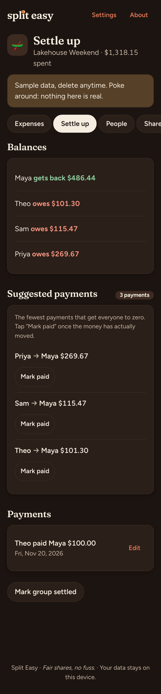
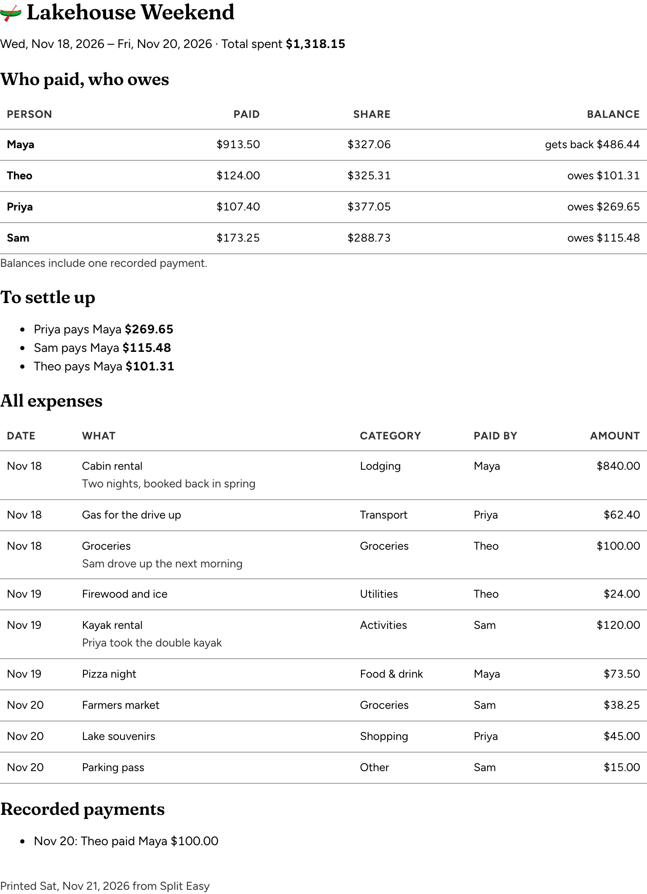

# Split Easy

**Fair shares, no fuss.** Trips, rent, dinners: we keep the math honest so you can keep the friends.

Split Easy keeps track of who paid for what in a group and works out the **fewest payments** that square everyone up. It runs entirely in the browser: no account, no server, no tracking. Data stays on the device, works offline, and a whole group can be handed to someone else as a single link.

| Home | Group | Settle up (dark) | Print summary |
|---|---|---|---|
|  |  |  |  |

## Features (v1)

- Groups with people, expenses, and categories. Split **equally**, **by shares**, or by **exact amounts**.
- Money is stored as **integer cents**. Every split adds up to the cent; leftover cents rotate fairly between people.
- **Settle up** with the minimum number of payments, "Mark paid", payment history, and "Mark group settled".
- **Share link** (the group travels inside the link's `#` fragment, which never reaches a server) with a safe merge preview, plus a **group file** fallback for very big groups.
- **CSV export** and a **printable summary**.
- **Dark mode**, keyboard and screen-reader friendly, works **offline** as an installable PWA.
- A **demo trip** ("Lakehouse Weekend") to try things out.

## Run it locally (port 8840)

You need Node.js (v20+; built with v24). Everything installs inside this folder, so no global installs or `sudo`.

```bash
npm install
npm run dev          # http://localhost:8840 (dev server, hot reload, no service worker)
```

Or double-click **`start-split-easy.command`** (in this folder or on the Desktop). It builds if needed, serves the production build on <http://localhost:8840>, and opens the browser. If Split Easy is already running it just opens the page. If something else is using port 8840 it refuses and leaves that app alone. Close the Terminal window to stop it.

Always use `http://localhost:8840` (not `127.0.0.1`): browsers keep saved data per address, so the two would look like different apps.

### Other commands

```bash
npm run typecheck    # TypeScript, strict
npm test             # unit + property tests (Vitest + fast-check, pinned seed)
npm run build        # production build to dist/ + JS/font budget check
npm run preview      # serve dist/ on http://localhost:8840 (service worker active)
npm run test:e2e     # Playwright smoke test (Chromium only; builds and serves on 8840)
```

The first time you run the end-to-end test, install its browser: `npx playwright install chromium`. Close the launcher first, because the test needs port 8840.

`node scripts/screenshots.mjs` regenerates `docs/screenshots/` and checks that an offline reload works.

## Deploy to Vercel (Hobby, free)

Split Easy is a static site. It needs **no environment variables and no secrets**.

1. Push this repo to a Git host you own (GitHub, GitLab, or Bitbucket). *(This repo has no remote configured yet.)*
2. In Vercel: **Add New → Project → Import** the repo.
3. Framework preset: **Vite**. Build command: `npm run build`. Output directory: `dist`. Leave environment variables empty.
4. Deploy.

Alternatively, from this folder: `npx vercel` (log in when asked), then `npx vercel --prod`.

`vercel.json` already sets the single-page-app rewrite and the cache headers (`no-cache` for `index.html`, `sw.js`, and the manifest; long-lived immutable caching for hashed files in `/assets`).

## Privacy and where data lives

- Groups are saved in the browser's `localStorage` under `split-easy:*` keys. Nothing is sent anywhere.
- A share link looks like `https://…/import#s1.<data>`. The part after `#` is never sent to the server, so group data doesn't show up in hosting logs. **Anyone with the link can see that group's names and amounts.**
- Opening a link never silently overwrites anything: you see a preview, can merge or save a separate copy, and can **Undo** right after.
- If saved data can't be read, it is moved aside (not deleted), and the app offers a download.

### iPhone / iPad notes

- Safari and the Home Screen app keep **separate storage**. If you add Split Easy to your Home Screen, move groups into it with a share link.
- Safari may clear data for sites you haven't opened in a long while. Split Easy asks the browser to keep its data, but a share link or group file is the reliable backup.
- To install: Share → **Add to Home Screen**.

## Project layout

```
src/lib/        pure, framework-free logic (money, split, settle, codec, merge, storage, csv) + tests
src/state/      the store (load, debounced save, other-tab handling) and actions
src/pages/      one file per screen
src/components/ shared UI pieces (wordmark, dialogs, amount input, split editor…)
src/styles/     tokens (light/dark palette), base, components, print, fonts
tests/e2e/      Playwright smoke test
```

See **[LEARN.md](LEARN.md)** for a beginner-friendly walk-through of how it was built, and **[PLAN.md](PLAN.md)** for the full design.

Fonts: Fraunces and Figtree, both SIL Open Font License, self-hosted.
